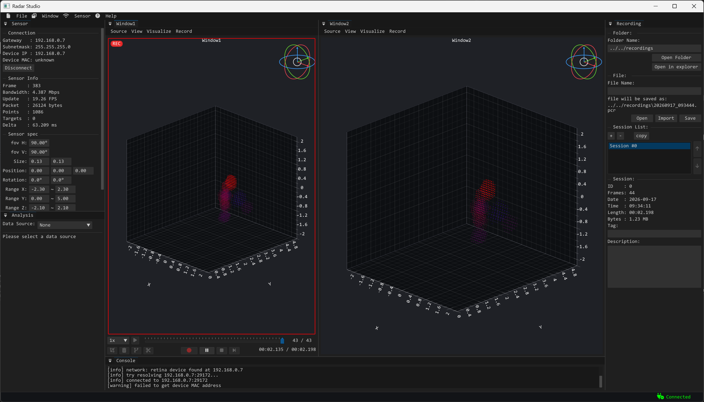
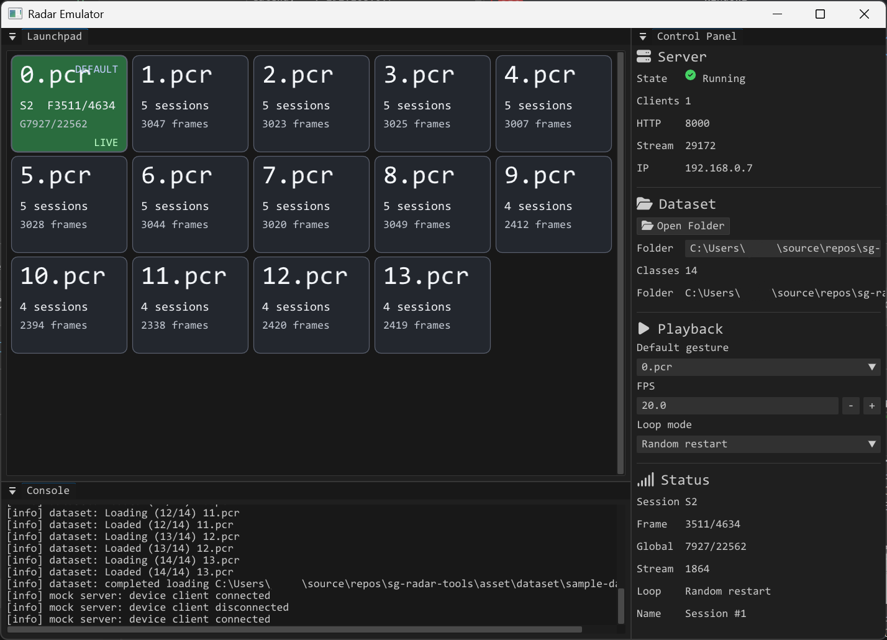

# sg-radar-tools

RETINA-4SN 레이더의 포인트 클라우드를 PC에서 수신하고 시각화·녹화·재생하는 Windows 도구입니다.
실제 센서가 없는 환경에서는 PCR 녹화 파일과 Radar Emulator로 수신 프로그램을 시험할 수 있습니다.
[dandevlog0206/sg-radar-tools](https://github.com/dandevlog0206/sg-radar-tools)를 기반으로 한
[jin-1031/sg-radar-tools](https://github.com/jin-1031/sg-radar-tools) 포크입니다.

| 프로그램 | 역할 |
| --- | --- |
| Radar Studio | 센서 탐색·연결, 포인트 클라우드 표시·분석, PCR 녹화·편집·재생 |
| Radar Emulator | PCR 파일을 읽어 센서와 호환되는 TCP 패킷으로 송출 |




## 주요 기능과 포크 개선사항

원본은 센서 자동 탐색, 최대 4개의 3D 뷰, 포인트·Target 통계와 히스토그램,
여러 Session의 PCR 녹화·편집·재생 및 Emulator 송출 기능을 제공합니다.

이 포크에는 다음 변경이 반영돼 있습니다.

- PCR → CSV 변환과 다중 Session 선택, 원본 프레임 번호·포인트 값 보존
- CSV의 정수 마이크로초 `timestamp_us`와 프레임 간 `delta_us` 누적
- TCP/HTTP 탐색 제한시간, 연결 오류 진단 및 자동 재연결
- 연결 종료 시 녹화 중단과 메모리 Session 보존
- Studio의 한글 로그·폰트·파일 경로 처리와 Recording 입력 검증
- Target Section·패킷 경계 검사와 손상된 스트림 이후 재동기화
- 렌더링과 분리된 PCR 녹화 FIFO, 최소화·창 접힘 중 녹화 처리와 상태 진단
- Visual Studio 2022 / v143 빌드 지원

## 요구사항

- Windows 10/11 x64와 OpenGL을 지원하는 그래픽 드라이버
- Visual Studio 2022 17.14 계열: **C++를 사용한 데스크톱 개발**, MSVC v143, Windows SDK
- Git for Windows: 저장소 다운로드용
- Python: PCR 읽기·CSV 변환에만 필요

C++ 프로젝트는 C++20을 사용합니다. Asio, GLFW, Dear ImGui, ImPlot/ImPlot3D, zstd는
`common/thirdparty/`에 포함되어 있으며 CMake나 별도 패키지 설치 없이 빌드합니다.
Python 로더는 `compression.zstd`가 있는 Python 3.14 이상을 사용하거나 `zstandard` 패키지가 필요합니다.

## 빠른 시작

### 다운로드와 빌드

일반 PowerShell에서 사용자 포크를 내려받습니다.

```powershell
git clone https://github.com/jin-1031/sg-radar-tools.git sg-radar-tools-elevsafe
Set-Location .\sg-radar-tools-elevsafe
```

Visual Studio에서 `sg-radar-tools.slnx`를 열고 **Release | x64**로 솔루션을 빌드합니다.
명령줄에서는 **Developer PowerShell for VS 2022**를 열고 저장소 루트에서 실행합니다.

```powershell
MSBuild .\sg-radar-tools.slnx /p:Configuration=Release /p:Platform=x64
```

출력 파일은 `bin/radar-studio/radar-studio.exe`와 `bin/radar-emulator/radar-emulator.exe`입니다.
Debug 구성은 같은 폴더에 이름 끝이 `-debug.exe`인 파일을 생성합니다.
재빌드 전에는 필요한 녹화를 저장하고 해당 프로그램을 정상 종료합니다.

### 프로그램 실행

다음 명령은 각각 저장소 루트에서 실행합니다. 두 프로그램을 함께 사용할 때는 PowerShell 창을 나눕니다.

```powershell
Push-Location .\bin\radar-studio
.\radar-studio.exe
Pop-Location
```

```powershell
Push-Location .\bin\radar-emulator
.\radar-emulator.exe
Pop-Location
```

프로그램 폴더를 작업 디렉터리로 사용해야 상대 경로의 폰트와 `imgui.ini`를 읽을 수 있습니다.
실행 파일만 다른 폴더로 옮기지 않습니다.

Emulator에서는 **Open Folder**로 PCR 폴더를 열고 **Default record**, **FPS**, **Loop mode**를 설정합니다.
Launchpad 버튼을 누르는 동안 해당 파일을 송출하고, 놓으면 기본 파일로 돌아갑니다.
Studio의 **Auto Connect**로 연결한 뒤 Point Cloud의 **Source > Sensor**에서 수신을 확인합니다.

Emulator는 HTTP 8000과 TCP 29172를 사용합니다. 시작 실패 시 Console에서 포트 점유 여부를 확인합니다.
PCR은 별도로 준비해야 하며 CSV를 Emulator 입력으로 사용할 수는 없습니다.
원본의 [샘플 데이터 링크](https://drive.dandevlog.com/s/XiTRfDSSRsnrP5t)는 참고용이며 현재 다운로드 가능 여부는 재검증하지 않았습니다.

## 실제 레이더 연결과 녹화

PC와 센서를 같은 네트워크에 연결하고 실제 IP·서브넷을 확인합니다. Studio의 **Auto Connect**는 선택된 로컬 서브넷에서 TCP 29172와 HTTP 8000 응답을 검사합니다.
각 탐색 probe의 제한시간은 1초이며 전체 서브넷 탐색 시간이 1초라는 뜻은 아닙니다.
TCP 연결 성공만으로 HTTP 탐색이나 정상 프레임 수신을 보장하지 않으므로 Console과 점 갱신을 함께 확인합니다.

Windows에서 처음 발견한 활성 비-loopback IPv4를 사용하므로 WSL·VPN 등 가상 어댑터가 선택될 수 있습니다.
Console의 로컬 IP·mask·탐색 범위를 센서 네트워크와 비교합니다. 최초 연결용 직접 IP 입력 UI는 없습니다.
네트워크가 맞는데 탐색이 실패하면 센서의 HTTP 서비스, 허용 IP, 방화벽 규칙을 확인합니다.

녹화와 저장은 다음 순서로 진행합니다.

1. 센서 연결 후 **Source > Sensor**에서 실시간 데이터가 계속 갱신되는지 확인합니다.
2. **Recording**에서 녹화할 Session을 선택합니다.
3. Point Cloud의 **Source > Current Session**으로 전환합니다.
4. **Record**로 녹화를 시작하고 프레임 수가 증가하는지 확인합니다. 데이터는 먼저 메모리 Session에 쌓입니다.
5. **Pause**로 녹화를 마친 뒤 **Recording**에서 폴더·파일명을 설정하고 **Save**를 누릅니다.
6. 저장 파일과 Console의 성공 로그를 확인하고, 필요하면 **Open**으로 다시 읽어 봅니다.

기본 저장 순서는 **Record → Pause → Save**입니다.
Save는 선택 Session만이 아니라 Recorder의 전체 Session을 저장합니다.
녹화 중 Save도 가능하지만 그 시점까지의 snapshot을 저장할 뿐 녹화를 끝내지는 않습니다.
Open은 현재 녹화를 교체하고 Import는 Session을 가져옵니다. Open/Import와 내용 편집은 Pause 후 수행합니다.

연결 오류 시 녹화를 중단하고 기존 Session을 메모리에 보존합니다. 파일 저장은 사용자가 해야 합니다.
재연결은 연결 종료 조건에 따라 2·4·8·15·30초 간격으로 최대 5회 시도하며 수동 Disconnect는 재시도하지 않습니다.
연결이 복구돼도 녹화는 자동 재개되지 않습니다. 다음 Record는 새 Session에서 시작합니다.
연결은 살아 있지만 데이터가 오지 않는 상황까지 자동 복구하는 기능은 없습니다.

파싱에 성공한 프레임은 callback에서 녹화 FIFO에 접수하고, 메인 루프가 렌더링 전에 Session에 반영합니다.
Studio가 최소화되거나 Point Cloud 창이 접혀도 이 경로는 유지됩니다.
FIFO 한도는 대기·처리 중 프레임 512개 또는 계산된 데이터 64MiB입니다.
한도를 넘으면 기존 접수분을 보존하고 불완전 상태로 녹화를 중단합니다. 완료된 Session 메모리는 별도로 누적됩니다.

Console의 `capture result`에서 `eligible`, `accepted`, `applied`, `enqueueFailed`, `pending`, `complete`, `error`를 확인합니다.
`complete=0`은 불완전 녹화입니다. Save 성공 로그만으로 수신·녹화 전체가 완료됐다고 판단하지 않습니다.
불완전 상태는 Console 진단으로 남고 PCR 1.0 파일에 별도 상태 필드를 추가하지 않습니다.

새 빈 Session의 첫 `deltaUs`는 0이고 이후 값은 파싱 성공 시점 사이의 경과 시간입니다.
파싱 실패가 있어도 다음 성공 프레임까지의 간격을 유지합니다. 센서 측정 시각이 아닌 PC 처리 시각입니다.
Pause 후 기존 Session에 이어 기록할 때 Pause 전체 시간을 새로 더하지 않으므로 Session 길이는 전체 벽시계 시간과 다를 수 있습니다.

## PCR → CSV 변환

저장소 루트의 일반 PowerShell에서 실행합니다. 아래 입력 PCR은 준비한 파일 경로로 바꿉니다.
`compression.zstd`를 사용할 수 없는 Python 환경에서만 의존성을 설치합니다.

```powershell
python -m pip install zstandard
```

Session이 하나인 PCR은 자동으로 선택합니다. 출력 CSV는 기존 파일과 다른 이름을 사용합니다.

```powershell
python tools/pcr/pcr_to_csv.py "recordings/sample.pcr" "recordings/sample.csv"
```

여러 Session이 있으면 0부터 시작하는 목록 index를 지정합니다. Session ID와는 구분합니다.

```powershell
python tools/pcr/pcr_to_csv.py "recordings/sample.pcr" "recordings/session0.csv" --session 0
```

출력 컬럼은 다음과 같습니다.

```csv
frame,timestamp_us,x,y,z,doppler,power,target_id
```

포인트 하나가 한 행입니다. 원본 프레임 번호와 포인트 값·Target ID를 유지하고 좌표나 단위를 변환하지 않습니다.
float32 값은 `.9g`로 출력하며 Target 레코드 전체를 별도 CSV로 내보내는 기능은 아닙니다.
`timestamp_us`는 선택 Session의 첫 프레임을 0으로 두고 두 번째 프레임부터 `delta_us`를 누적한 정수 µs입니다.
첫 프레임 delta는 무시하고 Session마다 다시 0부터 시작합니다. 빈 프레임은 행을 만들지 않지만 시간 누적에는 포함합니다.
기존 `timestamp_ms` CSV와 단위가 다르므로 사용하는 분석 코드의 컬럼과 단위를 확인합니다.

PCR 자체를 읽는 Python 예시는 `tools/pcr/example.py`, C++ Reader/Writer는
`common/pcr/point_cloud_recorder.{h,cpp}`에 있습니다.

## 라이선스와 원본 출처

원본: [dandevlog0206/sg-radar-tools](https://github.com/dandevlog0206/sg-radar-tools)
포크: [jin-1031/sg-radar-tools](https://github.com/jin-1031/sg-radar-tools)

코드는 [MIT License](LICENSE)를 따르며 원본 저작권 `Copyright (c) 2026 www.dandevlog.com`을 유지합니다.
서드파티 라이선스는 [common/thirdparty/NOTICE.txt](common/thirdparty/NOTICE.txt)에 정리돼 있습니다.
Font Awesome 폰트는 SIL OFL 1.1이며 [폰트 라이선스](asset/font/LICENSE.txt)를 함께 제공합니다.
