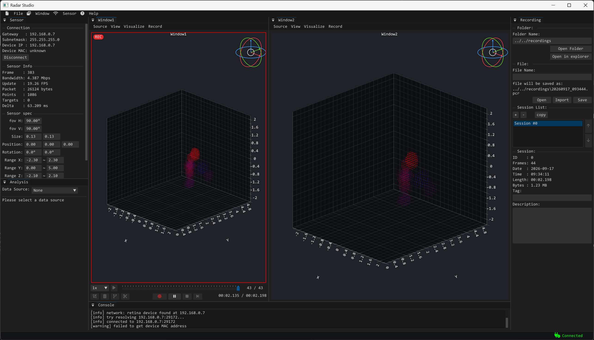
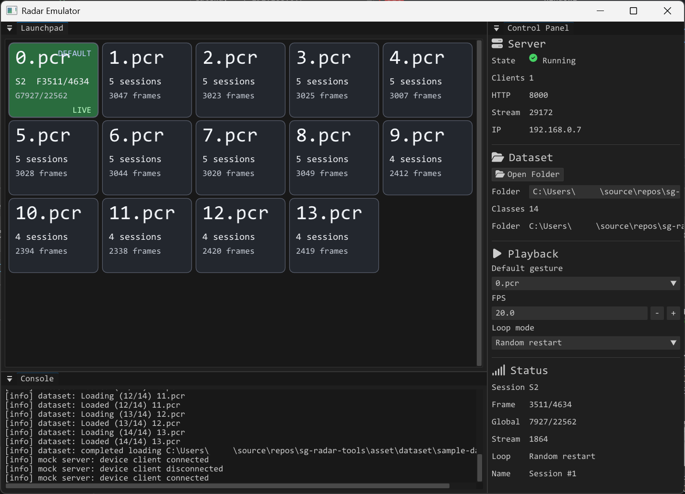

# sg-radar-tools

RETINA-4SN 레이더의 포인트 클라우드(공간에 있는 점 데이터)를 PC에서 보고, 녹화하고, 다시 재생하는 Windows 도구입니다. 실제 센서가 없어도 PCR 녹화 파일과 Radar Emulator로 수신 동작을 시험할 수 있습니다.

원본은 [dandevlog0206/sg-radar-tools](https://github.com/dandevlog0206/sg-radar-tools)이며, 이 포크는 [jin-1031/sg-radar-tools](https://github.com/jin-1031/sg-radar-tools)입니다. 아래 예시의 로컬 폴더명은 `sg-radar-tools-elevsafe`로 통일합니다.

## 목차

1. [프로젝트 소개](#1-프로젝트-소개)
2. [주요 기능](#2-주요-기능)
3. [프로그램 구성 및 화면](#3-프로그램-구성-및-화면)
4. [설치 전 준비사항](#4-설치-전-준비사항)
5. [Git 설치](#5-git-설치)
6. [Visual Studio 2022 설치](#6-visual-studio-2022-설치)
7. [저장소 다운로드](#7-저장소-다운로드)
8. [Visual Studio에서 빌드하기](#8-visual-studio에서-빌드하기)
9. [Developer PowerShell에서 빌드하기](#9-developer-powershell에서-빌드하기)
10. [Radar Studio 실행](#10-radar-studio-실행)
11. [Radar Emulator 실행 및 실습](#11-radar-emulator-실행-및-실습)
12. [실제 RETINA-4SN 연결](#12-실제-retina-4sn-연결)
13. [Point Cloud와 Recording 사용법](#13-point-cloud와-recording-사용법)
14. [TCP 자동 재연결](#14-tcp-자동-재연결)
15. [테스트 실행](#15-테스트-실행)
16. [문제 해결](#16-문제-해결)
17. [프로젝트 구조와 PCR 도구](#17-프로젝트-구조와-pcr-도구)
18. [제한사항 및 라이선스](#18-제한사항-및-라이선스)

## 1. 프로젝트 소개

| 프로그램 | 하는 일 |
| --- | --- |
| Radar Studio | 센서 탐색·연결, 실시간 3D 표시, 분석, PCR 녹화·편집·재생 |
| Radar Emulator | PCR 파일을 읽어 레이더와 호환되는 TCP 패킷으로 송출 |

PCR(`.pcr`, Point Cloud Recording)은 이 프로젝트의 레이더 녹화용 바이너리 파일입니다. CSV와는 다른 파일이며, Emulator에는 CSV가 아니라 PCR을 입력합니다.

## 2. 주요 기능

원본 도구는 센서 탐색, 포인트/타겟 시각화와 통계, 여러 Session의 녹화·편집·저장 및 Emulator 재생을 제공합니다.

이 포크의 현재 작업 코드에는 다음 개선이 있습니다. 해당 변경이 포함된 버전을 빌드해야 사용할 수 있습니다.

- VS2022/v143 빌드 설정과 PCR → CSV 변환 도구
- Discovery의 TCP/HTTP 탐색 제한시간 1000ms
- TCP 연결 종료 원인 진단 로그와 자동 재연결
- 연결 오류 시 녹화 중단 및 메모리 Session 보존
- Windows 한글 오류 로그, 한글 폰트, Recording의 Unicode 경로 처리
- 파일명 미리보기 안내와 실제 파일 작업 실패 로그 분리

Git clone은 원격에 반영된 파일만 받습니다. 아직 Commit/Push되지 않은 로컬 개선 사항은 다른 PC에서 clone해도 포함되지 않습니다.

## 3. 프로그램 구성 및 화면

### Radar Studio



| 창 | 역할 |
| --- | --- |
| Sensor | Auto Connect/Disconnect, 네트워크·센서 정보와 Sensor spec |
| Point Cloud | 실시간 또는 Session 데이터의 3D 표시·재생·녹화 조작. 최대 4개 뷰 |
| Recording | Session 목록, 파일 경로, Save/Open/Import |
| Analysis | 선택한 데이터의 포인트/타겟 통계 |
| Console | 연결·재연결·파일 작업 로그 |

### Radar Emulator



| 창 | 역할 |
| --- | --- |
| Control Panel | 서버 상태, Clients 수, Open Folder, Default record, FPS, Loop mode |
| Launchpad | PCR별 재생 버튼. 누르는 동안 해당 파일을 선택하며, 놓으면 기본 파일로 복귀 |
| Console | 서버 시작, 데이터 로드, 클라이언트 연결 및 오류 로그 |

스크린샷은 화면 구성 참고용입니다. 저장된 창 배치에 따라 실제 배치는 다를 수 있습니다.

## 4. 설치 전 준비사항

이 문서는 Windows 10/11 x64의 **Release | x64** 빌드를 기준으로 합니다. 프로젝트에는 Debug/Release 및 Win32/x64 설정도 있지만 다른 구성의 검증을 보장하는 의미는 아닙니다.

| 준비물 | 필요 여부와 목적 |
| --- | --- |
| Git for Windows | 아래 방법으로 소스를 다운로드할 때 필요 |
| Visual Studio 2022 17.14 계열 | C++ 프로그램 빌드에 사용하는 개발 도구 |
| MSVC v143 x64/x86 도구 | C++20 컴파일러. Visual Studio Installer에서 설치 |
| Windows SDK | Windows 헤더와 라이브러리. Visual Studio Installer에서 설치 |
| OpenGL 지원 그래픽 드라이버 | 화면 표시에 필요. 프로그램은 OpenGL 3.0 컨텍스트를 요청 |
| PCR 파일 | Emulator에서 실제 점 데이터를 재생할 때 필요 |
| Python | 선택 사항. PCR 읽기·CSV 변환·Python 테스트용 |
| MSYS2 | 선택 사항. 이미 이 환경의 Python을 사용하는 경우 참고 |

CMake, MSYS2, Python은 Studio/Emulator의 C++ 빌드 필수가 아닙니다. Asio, GLFW, Dear ImGui, ImPlot/ImPlot3D, zstd 등은 `common/thirdparty/`에 포함되어 있습니다. 별도 NuGet 복원이나 submodule/Git LFS 초기화 절차는 없습니다.

이 문서는 세 종류의 명령 창을 구분합니다.

- **일반 Windows PowerShell**: Git 확인, 폴더 이동, 프로그램 실행, Python 도구 실행
- **Developer PowerShell for VS 2022**: MSBuild를 사용할 수 있도록 개발 환경이 설정된 PowerShell
- **x64 Native Tools Command Prompt for VS 2022**: x64 C++ 테스트 컴파일에 사용할 명령 프롬프트(CMD)

명령 블록 앞의 환경과 경로를 확인하세요. 새 터미널은 이전 창에서 이동했던 경로를 유지하지 않을 수 있습니다.

## 5. Git 설치

1. 브라우저에서 [Git for Windows 공식 다운로드](https://git-scm.com/install/windows)를 엽니다.
2. Windows x64 설치 파일을 다운로드하고 실행합니다.
3. 특별한 요구가 없다면 설치 기본값을 사용합니다. PATH 관련 옵션에서는 Windows 명령줄에서도 Git을 사용할 수 있는 설정을 유지합니다.
4. 설치를 마친 뒤 기존 터미널을 닫습니다.
5. Windows 시작 메뉴에서 `Windows PowerShell`을 검색해 실행합니다. 이 단계는 일반 PowerShell이며 현재 디렉터리는 어디여도 됩니다.
6. 아래 명령을 입력합니다.

```powershell
git --version
```

`git version ...`이 출력되면 사용할 수 있습니다. 명령을 찾지 못하면 새 PowerShell 창에서도 같은지 확인한 뒤 Git 설치의 PATH 설정을 확인하세요.

## 6. Visual Studio 2022 설치

### 처음 설치하는 경우

1. [Microsoft의 Visual Studio 2022 다운로드 안내](https://learn.microsoft.com/en-us/visualstudio/releases/2022/release-history)를 엽니다.
2. `Evergreen bootstrappers` 표의 **Current / 17.14** 행에서 사용할 Edition을 선택합니다. 이 문서는 **Community** 설치를 기준으로 합니다. 다른 제품의 다운로드 버튼과 혼동해 VS2026을 설치하지 않도록 제품명을 확인하세요.
3. 다운로드한 설치 파일을 실행합니다. Windows 권한 확인이 나오면 내용을 확인하고 승인합니다.
4. Visual Studio Installer가 열리면 **워크로드(Workloads)** 탭을 선택합니다.
5. **C++를 사용한 데스크톱 개발(Desktop development with C++)**을 선택합니다.
6. 오른쪽 설치 세부 정보 또는 **개별 구성 요소(Individual components)** 탭에서 **MSVC v143 - VS 2022 C++ x64/x86 build tools** 계열과 **Windows 10 SDK 또는 Windows 11 SDK**가 포함되는지 확인합니다.
7. **설치(Install)**를 누르고 다운로드와 설치가 끝날 때까지 기다립니다. 이 프로젝트를 위해 CMake 도구, MFC, UWP 워크로드를 추가로 선택할 필요는 없습니다.
8. **시작(Launch)**을 눌러 Visual Studio 2022를 실행합니다. 최초 실행 설정은 화면 안내를 따릅니다.
9. 상단 **도움말(Help) > Microsoft Visual Studio 정보(About Microsoft Visual Studio)**에서 17.14 계열인지 확인합니다.

SDK는 프로젝트에서 `10.0` 계열로 지정되어 있으며 특정 패치 버전 하나에 고정되어 있지 않습니다. 설치된 Windows SDK가 하나 이상 있어야 합니다.

### 이미 설치한 경우

1. 시작 메뉴에서 **Visual Studio Installer**를 검색해 실행합니다.
2. 사용할 VS2022 설치 항목에서 **수정(Modify)**을 누릅니다.
3. 위 C++ 워크로드, v143, Windows SDK를 확인하고 누락된 항목을 선택합니다.
4. **수정(Modify)**을 눌러 적용하고 Visual Studio를 다시 실행합니다. 구버전이면 Installer의 **업데이트(Update)**도 확인합니다.

참고: [Microsoft 구성 요소 수정 안내](https://learn.microsoft.com/en-us/visualstudio/install/modify-visual-studio?view=vs-2022). `.slnx`의 MSBuild 빌드는 [17.13 이상 도구가 필요](https://devblogs.microsoft.com/visualstudio/new-simpler-solution-file-format/)하므로 이 가이드는 17.14를 기준으로 합니다.

## 7. 저장소 다운로드

아래 예시는 `C:\dev\sg-radar-tools-elevsafe`를 사용합니다. 다른 경로를 선택하면 이후 명령의 경로도 바꾸세요.

1. 시작 메뉴에서 **Windows PowerShell**을 엽니다.
2. 현재 디렉터리는 어디여도 됩니다. 아래 명령을 순서대로 실행해 상위 폴더를 만들고 소스를 받습니다.

```powershell
New-Item -ItemType Directory -Force C:\dev
Set-Location C:\dev
git clone https://github.com/jin-1031/sg-radar-tools.git sg-radar-tools-elevsafe
Set-Location C:\dev\sg-radar-tools-elevsafe
```

3. 같은 일반 PowerShell에서 위치와 필수 파일을 확인합니다.

```powershell
Get-Location
Test-Path .\sg-radar-tools.slnx
Test-Path .\radar-studio\radar-studio.vcxproj
Test-Path .\radar-emulator\radar-emulator.vcxproj
Test-Path .\asset\font\fa-solid-900.ttf
```

첫 출력의 경로가 저장소 루트이고 나머지는 모두 `True`여야 합니다. `False`라면 경로와 clone 완료 여부를 확인합니다. 같은 이름의 폴더가 이미 있으면 삭제하거나 덮어쓰지 말고 기존 작업 폴더인지 확인하세요.

`exe`, 빌드 중간 파일, `.venv`, `recordings/`, `*.pcr`는 Git 제외 대상입니다. clone 직후 exe와 PCR 데이터가 없는 것은 정상입니다.

## 8. Visual Studio에서 빌드하기

빌드는 소스를 실행 가능한 `.exe`로 만드는 과정입니다. **GUI 방식과 다음 절의 명령줄 방식 중 하나만 수행하면 됩니다.** 빌드 전 실행 중인 Studio/Emulator를 정상 종료해 exe 파일 잠금을 방지하세요.

1. **Visual Studio 2022**를 실행합니다.
2. 시작 화면에서 **프로젝트 또는 솔루션 열기(Open a project or solution)**를 누릅니다. 이미 편집 화면이면 **파일(File) > 열기(Open) > 프로젝트/솔루션(Project/Solution)**을 선택합니다.
3. `C:\dev\sg-radar-tools-elevsafe\sg-radar-tools.slnx`를 엽니다. Open Folder가 아니라 솔루션 파일을 여는 방식입니다.
4. 로드 후 **솔루션 탐색기(Solution Explorer)**에서 `radar-studio`, `radar-emulator` 프로젝트를 확인합니다. 창이 없으면 **보기(View) > 솔루션 탐색기(Solution Explorer)**를 선택합니다.
5. 상단 도구 모음의 솔루션 구성에서 **Release**, 플랫폼에서 **x64**를 선택합니다.
6. 선택 상자가 없거나 x64가 없다면 **빌드(Build) > 구성 관리자(Configuration Manager)**에서 **활성 솔루션 구성(Active solution configuration)**과 **활성 솔루션 플랫폼(Active solution platform)**을 확인합니다. 현재 솔루션에 x64가 있으므로 임의로 새 플랫폼을 만들기 전에 올바른 솔루션을 열었는지 확인하세요.
7. **빌드(Build) > 솔루션 빌드(Build Solution)**를 누릅니다. Startup Project 설정은 솔루션 빌드의 필수 조건이 아닙니다.
8. **보기(View) > 출력(Output)**을 열고 **다음에서 출력 표시(Show output from)**에서 **빌드(Build)**를 선택합니다.
9. 완료 요약에서 **실패(Failed)가 0**인지 확인합니다. 오류가 있으면 출력 창의 첫 오류부터 확인합니다. 변경이 없으면 최신 상태(Up-to-date)로 표시될 수 있습니다.
10. 탐색기에서 다음 파일을 확인합니다.

```text
C:\dev\sg-radar-tools-elevsafe\bin\radar-studio\radar-studio.exe
C:\dev\sg-radar-tools-elevsafe\bin\radar-emulator\radar-emulator.exe
```

GUI 절차는 현재 솔루션과 프로젝트 설정을 기준으로 작성했습니다. 문서 개편 과정에서 GUI 빌드를 재실행하거나 새 PC에 설치해 검증하지는 않았습니다. 기존 로컬 빌드 검증은 MSBuild 기반입니다.

## 9. Developer PowerShell에서 빌드하기

1. 시작 메뉴에서 **Developer PowerShell for VS 2022**를 검색해 실행합니다. 일반 PowerShell과 달리 MSBuild 등을 찾을 수 있도록 환경이 설정됩니다.
2. 시작 메뉴 항목이 없다면 Visual Studio 2022의 **도구(Tools) > 명령줄(Command Line) > 개발자 PowerShell(Developer PowerShell)**을 엽니다.
3. 열린 Developer PowerShell에서 저장소 루트로 이동한 뒤 빌드합니다.

```powershell
Set-Location C:\dev\sg-radar-tools-elevsafe
MSBuild .\sg-radar-tools.slnx /p:Configuration=Release /p:Platform=x64
```

4. 종료 요약에서 실패가 없는지 확인합니다. 같은 창에서 파일 확인 명령을 실행합니다.

```powershell
Test-Path .\bin\radar-studio\radar-studio.exe
Test-Path .\bin\radar-emulator\radar-emulator.exe
```

두 결과가 `True`여야 합니다. 이전 exe도 존재할 수 있으므로 파일 존재만으로 성공을 판단하지 말고 MSBuild 결과도 확인하세요.

일반 PowerShell에서 MSBuild를 찾지 못하면 Developer PowerShell을 다시 여세요. 솔루션 빌드는 저장소 루트를 `SolutionDir`로 사용합니다. 프로젝트 하나를 별도로 빌드한 과거 결과물이 `radar-studio/bin/` 등에 남아 있더라도 아래 가이드는 **루트 `bin/`의 exe**를 사용합니다.

Debug 빌드는 같은 출력 폴더에 `radar-studio-debug.exe`, `radar-emulator-debug.exe`를 만듭니다. 이 문서의 기준은 Release x64입니다.

## 10. Radar Studio 실행

1. 시작 메뉴에서 **Windows PowerShell**을 새로 엽니다. 실행에는 Developer PowerShell이 필요하지 않습니다.
2. 현재 위치가 어디든 아래 명령으로 **Studio 실행 폴더에 먼저 이동**한 뒤 실행합니다.

```powershell
Set-Location C:\dev\sg-radar-tools-elevsafe\bin\radar-studio
.\radar-studio.exe
```

3. Studio 창과 Sensor, Point Cloud, Recording, Console 패널을 확인합니다. 패널이 닫혀 있으면 상단 **View** 메뉴에서 필요한 창을 켭니다. 연결 전 Disconnected 또는 데이터가 없는 상태는 정상입니다.
4. 종료 전 필요한 녹화를 **Recording > Save**로 저장합니다. 창의 닫기 버튼 또는 **File > Exit**로 정상 종료합니다. 프로세스를 강제 종료하는 방식은 피하세요.

Font Awesome은 `../../asset/font/fa-solid-900.ttf`, 창 배치는 현재 디렉터리의 `imgui.ini`를 사용합니다. exe만 다른 폴더에 복사하거나 저장소 루트에서 전체 exe 경로만 지정해 실행하면 상대 리소스 경로가 달라질 수 있습니다.

Studio는 시스템의 Consolas와 설치된 `C:/Windows/Fonts/malgun.ttf`를 사용합니다. 한글 폰트가 없으면 Console 경고 후 기존 폰트를 유지합니다. 시스템 폰트 파일을 별도로 복사하거나 저장소에 포함하지 않습니다.

## 11. Radar Emulator 실행 및 실습

### PCR 데이터 준비

Git으로 추적되는 PCR 샘플은 없습니다. 직접 녹화한 PCR 또는 제공받은 데이터를 별도 폴더에 준비하세요. 데이터가 없어도 프로그램 창과 서버는 실행할 수 있지만 점 데이터를 재생할 수 없습니다.

기존 프로젝트의 [외부 샘플 데이터 주소](https://drive.dandevlog.com/s/XiTRfDSSRsnrP5t)는 참고용으로 보존합니다. 문서 개편 시 다운로드 가능 여부와 파일 내용은 재검증하지 못했으므로 반드시 이용 가능하다고 가정하지 마세요.

### 실행과 연결

1. Studio 실행 창과 **별도의 일반 Windows PowerShell**을 엽니다.
2. Emulator 실행 폴더로 이동한 뒤 실행합니다.

```powershell
Set-Location C:\dev\sg-radar-tools-elevsafe\bin\radar-emulator
.\radar-emulator.exe
```

3. **Control Panel > Server**에서 State가 `Running`인지 확인합니다. HTTP는 **8000**, Stream은 **29172**입니다. 실패하면 Console과 포트 충돌을 확인합니다.
4. **Control Panel > Dataset > Open Folder**로 PCR이 있는 폴더를 선택합니다. 로딩 후 Launchpad에 파일별 버튼과 프레임 수가 나타납니다.
5. **Playback > Default record**에서 프레임이 있는 파일을 선택합니다. 버튼을 누르지 않을 때는 기본 파일이 재생됩니다.
6. **FPS**에서 송출 프레임레이트를 정합니다. 코드는 1~240으로 제한합니다. 제공받은 데이터의 실습 목적에 맞게 선택하세요.
7. **Loop mode**를 정합니다. `Random restart`는 임의 위치, `Restart from beginning`은 끝에 도달한 뒤 처음, `Restart from hold start`는 활성화 시작 위치로 돌아갑니다. 단발 재생 옵션은 없으며 파일 활성화 시 최초 위치도 임의로 선택됩니다.
8. Studio가 꺼져 있으면 앞 절의 방법으로 실행합니다. Studio **Sensor > Auto Connect**를 누릅니다.
9. Studio 연결 상태·Device IP와 Emulator Clients 증가를 확인합니다. Discovery 임시 접속도 있으므로 Clients 숫자만으로 수신 성공을 단정하지 않습니다.
10. Studio Point Cloud의 **Source > Sensor**를 선택하고 점 갱신을 확인합니다. 데이터에 따라 포인트가 없는 프레임도 있을 수 있습니다.

Launchpad 버튼은 누르는 동안 해당 파일을 재생하고, 놓으면 Default record로 돌아갑니다. Emulator는 PCR 원본 `frameCount`를 새 stream 번호로 바꾸며 송출 간격은 FPS 기준입니다. 원본 번호·`deltaUs` 보존이 목적이면 17절의 오프라인 도구를 사용하세요.

**Emulator를 최소화하면 프레임 송출이 중단됩니다.** 실습 중 최소화하지 마세요. 서버 소켓은 남아 있을 수 있어 Studio가 연결 상태여도 점 갱신이 멈출 수 있습니다.

### 자동 재연결 확인

필요한 데이터는 먼저 Save하세요. Emulator를 정상 종료하면 Studio가 수신 오류를 감지할 수 있습니다. 재시도 예산이 남아 있을 때 Emulator를 다시 실행하고 PCR 폴더와 기본 파일을 선택합니다. Studio Console의 `reconnect: recovered`와 점 갱신을 확인합니다. Record는 자동 재개되지 않습니다. EOF/RST 중 어느 오류가 나타나는지는 종료 상황에 따라 달라집니다.

## 12. 실제 RETINA-4SN 연결

Emulator 성공이 실제 센서 연결 안정성을 보장하지는 않습니다.

1. 제조사 설정에 따라 레이더를 켜고 네트워크를 준비합니다. PC가 레이더 AP에 직접 연결하거나, PC와 레이더를 휴대폰 핫스팟 등 통신 가능한 같은 네트워크에 연결합니다.
2. Windows 작업 표시줄의 네트워크 아이콘에서 의도한 Wi-Fi 연결인지 확인합니다. SSID, 비밀번호, IP는 실제 장치 설정이나 관리자에게 확인하며 고정 기본값을 가정하지 않습니다.
3. **일반 PowerShell**을 열고 아래 명령으로 PC IPv4 주소와 서브넷 마스크를 확인합니다. 현재 디렉터리는 어디여도 됩니다.

```powershell
ipconfig
```

4. 센서의 실제 IP를 확인합니다. 관리자 페이지는 브라우저에 `http://센서IP:8000` 형식으로 입력하되 센서IP를 실제 값으로 바꿉니다. Client 접근 허용 범위에 PC IP가 포함되는지도 확인합니다. 보안 정책에 맞춰 필요한 범위만 허용하세요.
5. 필요하면 같은 일반 PowerShell에서 기본 연결을 검사합니다. 아래 IP는 반드시 실제 센서 IP로 바꿉니다.

```powershell
$radarIp = '192.168.30.1'
ping $radarIp
Test-NetConnection -ComputerName $radarIp -Port 29172
Test-NetConnection -ComputerName $radarIp -Port 8000
```

6. Studio **Sensor > Auto Connect**를 누르고 Console의 `local ip`, `mask`, `scanning range`를 확인합니다. 자동 선택한 네트워크 어댑터의 subnet(서브넷)을 탐색합니다. Sensor의 `Gateway` 표시는 코드상 PC 로컬 IP이므로 실제 기본 게이트웨이와 혼동하지 마세요.
7. Device IP와 Point Cloud의 **Source > Sensor**에서 실제 점 갱신을 확인합니다.

최초 연결용 직접 IP 입력 UI/CLI는 없습니다. 내부 `MyApp::connect(host)`가 있다고 UI에서 IP를 지정할 수 있는 것은 아닙니다. 여러 어댑터나 VPN이 있으면 다른 subnet이 선택될 수 있습니다.

Discovery는 TCP 29172 접속 후 HTTP 8000 요청/응답을 각각 1000ms 제한으로 확인합니다. ping/TCP 성공만으로 Discovery나 지속 스트리밍 성공을 판단할 수 없습니다. Windows 방화벽, 네트워크 격리, 센서 서비스와 허용 IP를 별도로 확인하세요. 방화벽 전체 해제를 기본 해결책으로 사용하지 않습니다.

## 13. Point Cloud와 Recording 사용법

### Source 선택

| Source | 용도 |
| --- | --- |
| None | 데이터 소스를 선택하지 않은 상태 |
| Sensor | 최신 실시간 레이더 데이터 보기 |
| Current Session | Recording 창에서 현재 선택한 메모리 Session 보기·녹화·재생 |
| Session | Recorder의 특정 Session을 골라 보기·녹화·재생 |

Session은 한 묶음의 프레임입니다. Open한 파일도 메모리 Recorder로 읽습니다. Session 선택이 디스크 자동 저장을 의미하지는 않습니다.

### Record/Pause/Stop/Save의 차이

| 위치와 버튼 | 실제 동작 |
| --- | --- |
| Point Cloud의 빨간 원형 Record | 센서 프레임을 메모리 Session에 기록 시작. 일반 재녹화에서는 재생 커서 뒤 기존 프레임을 제거할 수 있음 |
| Point Cloud의 Pause | 녹화 일시중지. 기록된 프레임 유지 |
| Point Cloud의 Resume(삼각형) | 조건이 맞으면 녹화 재개 |
| Point Cloud의 사각형 Stop | 사용 가능한 상태에서 **선택 Session의 프레임 삭제**. 일반적인 녹화 종료로 사용하지 말 것 |
| Recording의 Save | Recorder의 **전체 Session**을 하나의 PCR로 저장 |

**보존하려면 `Record → Pause → Save` 순서를 사용하세요. `Record → Stop → Save`로 안내하지 않습니다.**

### 처음 녹화하고 저장하기

1. 센서 또는 Emulator를 연결하고 유효 프레임 수신을 확인합니다.
2. Recording에서 저장할 Session을 선택합니다. 처음에는 기본 빈 Session이 있습니다. 기존 데이터를 보존하며 새로 시작하려면 Session List의 **+**를 누릅니다.
3. Point Cloud의 **Source > Current Session**을 선택합니다. Sensor 실시간 보기와 녹화 모드를 혼동하지 마세요.
4. Point Cloud의 **빨간 원형 Record**를 누르고 프레임 수 증가를 확인합니다. 이 단계는 파일이 아니라 메모리에 기록합니다.
5. 필요한 구간이 끝나면 **Pause**를 누릅니다. 사각형 Stop은 누르지 않습니다.
6. Recording의 **Folder Name**을 입력하거나 **Open Folder**로 저장 폴더를 선택합니다.
7. **File Name**에 확장자 없는 이름을 입력하고 `file will be saved as:` 경로를 확인합니다. `.pcr`은 자동으로 붙습니다. 빈 이름은 날짜·시간 이름이 되고, 중복 이름에는 `(1)`, `(2)`가 붙습니다.
8. Recording의 **Save**를 누릅니다. 폴더가 없으면 생성을 시도합니다. Console의 `recording saved to`와 실제 파일을 확인합니다. 오류가 있으면 성공으로 간주하지 않습니다.
9. 저장을 확인한 뒤 프로그램을 종료합니다. Save 전 종료나 Open으로 인한 Recorder 교체는 미저장 데이터 손실로 이어질 수 있습니다.

상단 **File**의 New/Open/Save Recording 항목은 현재 실행 코드가 비어 있습니다. 실제 파일 작업에는 **Recording 창의 Open/Import/Save**를 사용하세요. 편집·녹화 재개 전 기존 파일을 보관하는 것이 안전합니다.

### Open과 Import

- **Open**: 현재 Recorder를 읽어 온 PCR 내용으로 교체합니다. 기존 미저장 녹화를 먼저 Save하세요.
- **Import**: 기존 Session을 유지하며 읽어 온 Session을 새 ID로 추가합니다. 이름에 ` (Imported)`가 붙고 중복되면 suffix가 추가됩니다. 프레임을 기존 Session 하나로 합치지 않습니다.
- 읽어 온 데이터는 Point Cloud의 **Current Session** 또는 **Session**에서 골라 재생합니다.
- Import는 Reader/Recorder 자동 테스트에 포함되지만 실제 GUI 수동 검증 완료로 간주하지 않습니다.

### 한글 파일명과 경로

Recording 입력은 UTF-8, 파일 접근은 Windows native Unicode 경로를 사용합니다. `가 나`, `test file`, `레이더 데이터` 같은 내부 공백은 허용합니다. 끝 공백·마침표, Windows 금지 문자와 예약 이름은 거부합니다. 이름을 자동 trim하지 않습니다.

입력 중 일시적으로 이름이 유효하지 않으면 UI 안내와 Save 비활성화로 처리하고, 정상 입력이면 안내가 사라집니다. 미리보기 실패는 Console 오류로 남기지 않지만 실제 Save/Open/Import 실패는 기록합니다. 실패한 저장을 성공으로 표시하지 않습니다.

각 입력은 최대 **255 UTF-8 바이트**이며 한글의 글자 수와 바이트 수는 다릅니다. 긴 선택값은 자르지 않고 거부합니다. Recording UI는 절대 경로 **259 UTF-16 코드 단위**까지 지원하고 확장 길이 경로는 지원하지 않습니다.

공통 Windows Dialog는 기존 ACP(Windows 기본 좁은 문자 인코딩) 반환 방식을 유지합니다. Recording 경계에서 UTF-8/native 경로로 변환하지만 ACP 변환에서 이미 치환된 문자는 복원할 수 없습니다. 모든 Windows 파일명의 Dialog 지원을 보장하지 않습니다.

## 14. TCP 자동 재연결

예기치 않은 EOF, Windows connection reset(10054) 등 대상 TCP 오류가 발생하면 마지막 레이더 IP로 직접 재연결합니다. Discovery fallback은 하지 않습니다.

- 대기 간격: **2초 → 4초 → 8초 → 15초 → 30초**, 최대 **5회**
- 복구 판정: TCP connect만이 아니라 **첫 유효 프레임 수신**에서 `reconnect: recovered` 기록
- 횟수 초기화: 첫 유효 프레임 이후 연결이 **30초 유지**된 경우
- 사용자 Disconnect/탐색 취소/Exit: 자동 재연결하지 않음
- 대기 중 취소: 기존 Disconnect 버튼 사용
- 각 시도: 이전 비동기 작업과 I/O 스레드 정리 후 새 client와 io_context 생성

간격은 재시도 대기시간이며 OS의 TCP 연결 완료까지 포함한 전체 시간을 보장하지 않습니다. 5회 실패하면 `reconnect: exhausted`를 기록하고 중단합니다. 센서·네트워크를 확인한 뒤 **Auto Connect**로 다시 시작할 수 있습니다.

오류 시 진행 중인 Record는 중단하지만 메모리 Session과 프레임은 보존합니다. 수신이 복구되어도 **Record는 자동 재개하지 않습니다.** 다시 Record를 시작하면 새 Session에 기록하고 기존 Save로 이전·새 Session을 함께 저장할 수 있습니다. 오류 시 자동 저장·파일 분리·flush/close·단절 시간 보정은 하지 않습니다.

Studio는 최소화 상태에서도 재연결을 관리하지만 녹화는 UI 갱신에 의존해 모든 프레임의 백그라운드 기록을 보장하지 않습니다. 재연결 중 누락된 프레임은 복구하지 않습니다. 연결된 채 데이터만 멈추면 복구가 시작되지 않을 수 있습니다. 새 read timeout이나 keepalive 간격은 추가하지 않았으며, 모든 네트워크 문제를 해결하는 기능이 아닙니다. 실제 센서 장시간 검증은 별도로 필요합니다.

### 진단 로그

Console은 연결, read 오류, 종료 요청, `io_context.run()` 반환, 객체 정리를 기록합니다. 앱을 닫기 전 다음 정보를 기록하세요.

- `eventUnixMs`: 오류 시각(Unix epoch 밀리초)
- `code`, `category`, `message`: 오류 식별 정보. 메시지가 읽기 어려워도 숫자/category 보관
- `connectedMs`, `lastReceiveAgeMs`, `lastValidFrameAgeMs`: 연결·마지막 수신·마지막 유효 프레임 이후 시간. `-1`은 해당 이벤트 없음
- `bytesTransferred`, `shutdownRequested`, 재연결 attempt와 결과

종료 reason은 `user_disconnect_or_cancel`, `connect_preparation`, `program_exit`입니다. 명시적 종료 뒤 read 오류는 `[info]`로 구분합니다. Windows system/Asio system 메시지는 Unicode 원문에서 UTF-8로 변환하며 Console 전체를 ACP로 취급하지 않습니다. 로그는 메모리에만 남고 자동 파일 저장되지 않습니다. 정상 종료 로그는 창이 닫혀 확인하지 못할 수 있습니다.

## 15. 테스트 실행

이전 로컬 검증 기록은 **Release x64 빌드 성공, Python 22개 PASS, C++ 테스트 실행파일 6개 PASS**입니다. README 개편 과정에서는 새 설치·GUI 빌드·테스트를 재실행하지 않았으므로 새 환경 검증 결과로 해석하지 마세요.

### Python 테스트

Python은 선택 설치입니다. 필요하면 [Python 공식 Windows 다운로드](https://www.python.org/downloads/windows/)에서 설치 파일을 받아 실행합니다. Windows installer를 사용하면 Python 명령의 PATH 추가 옵션을 확인하고 설치합니다. 다른 배포 방식은 해당 안내를 따릅니다.

**일반 PowerShell**을 새로 열어 저장소 루트로 이동한 뒤 실행합니다.

```powershell
Set-Location C:\dev\sg-radar-tools-elevsafe
python --version
python -B -m unittest discover -s tools/pcr/tests -v
```

현재 테스트 코드 기준 `Ran 22 tests`와 `OK`가 성공 기준입니다. `FAILED`, traceback, non-zero 종료는 실패입니다. 주로 CSV 정책·CLI 오류 처리를 검사하며 센서/전체 GUI 테스트를 대체하지 않습니다. 실제 PCR의 zstd 의존성은 17절을 참고하세요.

### C++ 테스트

**먼저 Studio Release x64 빌드를 완료해야 합니다.** runner가 기존 빌드의 Recorder, zstd, ImGui object 파일을 링크하므로 깨끗한 clone에서 runner만 실행하면 필요한 파일이 없습니다.

1. Studio/Emulator를 정상 종료하고 TCP **29172**를 쓰는 다른 로컬 서버도 없는지 확인합니다.
2. 시작 메뉴에서 **x64 Native Tools Command Prompt for VS 2022**를 검색해 실행합니다. 일반 CMD가 아니라 x64 C++ 환경이 설정된 창입니다.
3. 이 창은 CMD 문법을 사용합니다. 저장소 루트로 이동해 실행합니다.

```bat
cd /d C:\dev\sg-radar-tools-elevsafe
radar-studio\tests\run_tests.cmd
echo %ERRORLEVEL%
```

4. 아래 6개 PASS 메시지와 종료 코드 `0`을 확인합니다. runner는 실패 시 중단합니다.

```text
Reconnect policy tests PASS
Retina connection tests PASS (loopback 29172)
Recorder session roundtrip tests PASS
UTF-8 log tests PASS
Korean font tests PASS
Recording UTF-8 path tests PASS
```

일부 메시지에는 ACP 값이나 CPU 렌더링 설명이 덧붙습니다. 산출물은 Git 제외 대상 `radar-studio/x64/Release/tests/`에 생성합니다. TCP 테스트는 기존 Emulator encoder, loopback, EOF/RST, 명시적 취소·반복 연결을 검사합니다. Recorder Session roundtrip, UTF-8, CPU 글리프, Unicode 경로 Save/Open/Import, 미리보기 상태도 검사합니다. 실제 GUI/IME·레이더 장시간 시험은 별도입니다.

이미 **x64 타깃으로 초기화된 Developer PowerShell**을 사용한다면 저장소 루트에서 아래처럼 실행할 수 있습니다. 환경이 불분명하면 위 Native Tools 창을 사용하세요.

```powershell
Set-Location C:\dev\sg-radar-tools-elevsafe
.\radar-studio\tests\run_tests.cmd
$LASTEXITCODE
```

## 16. 문제 해결

| 증상 | 가능한 원인과 확인할 조치 |
| --- | --- |
| `git`를 찾지 못함 | 설치 후 새 일반 PowerShell에서 `git --version` 확인. 계속 실패하면 설치 PATH 확인 |
| `.slnx`를 열지 못함 | VS2022 17.14로 업데이트하고 Open Folder가 아닌 프로젝트/솔루션 열기 사용 |
| MSB8020, v143 누락 | Installer > 수정에서 MSVC v143 x64/x86 설치. 임의의 toolset 변경은 하지 않음 |
| Windows SDK 누락 | Installer에서 Windows 10/11 SDK 설치 후 재빌드 |
| `MSBuild`를 찾지 못함 | Developer PowerShell for VS 2022 실행 |
| exe가 없거나 빌드 실패 | Release/x64와 Output의 첫 오류 확인. 루트 `bin/` 확인. 과거 exe 존재만으로 성공 판단 금지 |
| LNK1104, exe 잠금 | 필요한 데이터를 Save한 뒤 실행 중인 프로그램을 정상 종료하고 재빌드. 강제 종료·삭제부터 하지 않음 |
| DLL/OpenGL 초기화 실패 | 오류 DLL 이름 기록, VS C++ 설치·필요한 MSVC 런타임·그래픽 드라이버 확인. 임의 사이트의 DLL 다운로드 금지 |
| 아이콘/리소스 누락 | 각 `bin/radar-studio`, `bin/radar-emulator`로 이동 후 실행. Font Awesome 파일과 시스템 폰트 확인 |
| Emulator 서버 Stopped | Console에서 8000/29172 bind 오류와 다른 서버의 포트 점유 확인 |
| Emulator Discovery 실패 | State Running, 어댑터 선택, 방화벽과 두 포트 확인. PCR 송출 여부는 연결과 별도로 확인 |
| Auto Connect 실패 | PC/센서 IP·서브넷, 어댑터/VPN, 네트워크 격리, 센서 허용 IP와 두 포트 확인. ping만으로 판단하지 않음 |
| 연결됐지만 점이 멈춤 | Source, Emulator 최소화·빈 데이터 확인. 오류 없는 무수신은 자동 복구가 시작되지 않을 수 있음 |
| TCP 종료/재연결 소진 | Console의 code/category/시각·attempt 보관. 센서·네트워크 확인 후 Auto Connect 재실행 |
| Record 후 파일이 없음 | 메모리 녹화와 Save는 별개. Pause 후 Recording > Save, 경로와 성공 로그 확인 |
| Save 비활성화 | UI 안내 확인. 끝 공백/마침표, 금지·예약 이름, 폴더·경로/버퍼 길이 수정. 내부 공백은 허용 |
| 한글 경로 일부가 `?` | Dialog ACP 변환 손실 가능. 입력과 실제 미리보기 경로 확인. 이미 손실된 문자는 복원되지 않음 |
| Save/Open/Import 실패 | Console 경로·오류, 권한·저장 공간·파일 유효성 확인. 실패 뒤 정상 저장을 가정하지 않음 |
| C++ 테스트 링크/29172 오류 | Studio Release x64 선행 빌드, x64 개발 명령 창, 포트 점유 확인 |

Emulator에서 `failed to get device MAC address`가 나타날 수 있습니다. MAC 조회가 Windows ARP 테이블을 사용해 같은 PC의 Emulator에는 항목이 없을 수 있습니다. 이 경고만으로 연결/재연결 실패로 판단하지 말고 실제 프레임 수신을 확인하세요.

## 17. 프로젝트 구조와 PCR 도구

```text
sg-radar-tools-elevsafe/
  sg-radar-tools.slnx          두 프로그램의 솔루션
  radar-studio/               센서 수신, 재연결, Studio UI, C++ 테스트
  radar-emulator/             PCR 로드, 재생, TCP 서버, UI
  common/                    네트워크, Dialog, PCR Recorder/Reader, 공통 UI
    util/                    Console 및 UTF-8 유틸리티
    thirdparty/              동봉 라이브러리와 라이선스
  tools/pcr/                 Python Reader, CSV 변환, Python 테스트
  asset/font/                Font Awesome 폰트와 라이선스
  docs/                      프로그램 스크린샷
  bin/radar-studio/           Studio 실행 폴더
  bin/radar-emulator/         Emulator 실행 폴더
  recordings/                로컬 녹화 파일. Git 제외, 사용 중 생성 가능
```

### 센서 통신과 C++ PCR Reader

- `radar-studio/src/device/retina.{h,cpp}`: `DeviceFinder::find()`의 동기 탐색, `cancel()`, `DeviceClient`의 비동기 연결/수신. standalone Asio, 공통 network 및 UTF-8 유틸리티에 의존합니다.
- `getFrames()`로 프레임을 읽거나 `setOnFrame()`에 콜백을 연결합니다. 객체 수명·취소 관리와 함께 사용해야 하며 파일 하나만 복사하면 완성되는 API는 아닙니다.
- `common/pcr/pcr_format.h`: 디스크 레이아웃, `pcr_type.h`: 런타임 자료형
- `common/pcr/point_cloud_recorder.h`: `PointCloudRecorder`의 Session 관리, `serializeToStream()`, `deserializeFromStream()`

### Python PCR Reader와 zstd

Reader는 `tools/pcr/pcr_loader.py`, 예시는 `tools/pcr/example.py`입니다. Python 3.14 이상은 표준 `compression.zstd`를 사용합니다. 이 모듈이 없는 환경에서는 `zstandard` package가 필요합니다.

**일반 Python을 사용하는 일반 PowerShell**, 저장소 루트에서 필요할 때 설치합니다.

```powershell
Set-Location C:\dev\sg-radar-tools-elevsafe
python -m pip install zstandard
```

MSYS2 같은 externally-managed 환경에서는 시스템 Python에 pip로 강제 설치하지 말고 해당 package manager를 사용하세요. [MSYS2 공식 안내](https://www.msys2.org/)는 선택 환경 참고 자료입니다. 기존 **MSYS2 MinGW64 터미널**에서는 다음 방법으로 설치했습니다. 현재 디렉터리는 어디여도 됩니다.

```bash
pacman -S --needed mingw-w64-x86_64-python-zstandard
```

Reader 실행은 **일반 PowerShell**, 저장소 루트에서 합니다. `C:\data\sample.pcr`은 준비한 실제 경로로 바꾸고 공백이 있으면 따옴표를 유지하세요.

```powershell
Set-Location C:\dev\sg-radar-tools-elevsafe
python tools/pcr/example.py "C:\data\sample.pcr"
```

Session·프레임 수와 일부 포인트/타겟 값이 출력됩니다. 인자 없는 `python tools/pcr/example.py`도 있지만 기본 위치 `asset/dataset/sample/`에 PCR을 별도로 준비해야 하므로 clone만으로 성공하지 않습니다.

### PCR → CSV 변환

오프라인 분석용 도구이며 ElevSafe Backend의 실시간 모듈 간 Interface가 아닙니다. **일반 PowerShell**, 저장소 루트에서 입력·출력 경로를 준비한 위치로 바꿔 실행합니다. 출력은 기존 CSV와 다른 이름을 사용하세요.

```powershell
Set-Location C:\dev\sg-radar-tools-elevsafe
python tools/pcr/pcr_to_csv.py "C:\data\sample.pcr" "C:\data\sample_us.csv"
```

Session 하나는 자동 선택합니다. 여러 개면 같은 일반 PowerShell에서 0부터 시작하는 index를 지정합니다.

```powershell
python tools/pcr/pcr_to_csv.py "C:\data\sample.pcr" "C:\data\sample_session0_us.csv" --session 0
```

출력 컬럼 순서는 다음과 같습니다.

```csv
frame,timestamp_us,x,y,z,doppler,power,target_id
```

각 point가 한 행입니다. `frame`은 PCR 원본 번호이고 point 값·target ID는 보존합니다. float32 roundtrip을 위해 `.9g`를 사용하며 좌표·단위를 변환하지 않습니다. `timestamp_us`는 선택 Session의 첫 프레임을 0으로 두고 두 번째부터 현재 프레임의 `delta_us`를 누적한 **정수 마이크로초**입니다. 첫 프레임 delta는 무시하고 Session마다 초기화합니다. 같은 프레임의 point는 같은 시간입니다. 빈 프레임은 행을 만들지 않지만 이후 시간 누적에 포함됩니다.

기존 `timestamp_ms`의 `50`, `101.234`는 새 `timestamp_us`의 `50000`, `101234`입니다. PCR 간격 기반 상대 시간이며 Live Backend의 connection-relative 시간과 시작 시각이 같다는 뜻은 아닙니다. 기존 ms CSV를 보존하고 새 output path를 지정하세요. 소비 Reader의 정수 `timestamp_us` 지원을 확인해야 하며 다른 저장소의 현재 지원 상태는 이 문서가 보장하지 않습니다.

## 18. 제한사항 및 라이선스

### 검증 범위와 제한

- 기존 검증은 로컬 Release x64/MSBuild 및 자동 테스트 기준입니다. 새 설치 재현, GUI 빌드 클릭 경로, 최신 GUI/IME 입력과 GUI Import를 모두 검증했다는 의미는 아닙니다.
- 실물 AP/핫스팟 연결·수신 사례가 있어도 모든 장비·네트워크의 장시간 안정성을 보장하지 않습니다. Discovery 실패와 연결 후 EOF/RST는 별도로 조사합니다.
- Studio 녹화는 UI에서 최신 프레임을 기록하므로 모든 TCP 프레임 보존을 보장하지 않습니다. 미저장 데이터 자동 복구·자동 파일 저장은 없습니다.
- Emulator 최소화 시 송출이 중단되며 원본 PCR 번호·시간 간격을 그대로 보존하는 재생 도구가 아닙니다.
- Recording의 UTF-8/native 경로에도 공통 Dialog ACP와 입력/경로 길이 제한이 남아 있습니다. 미리보기 안내는 파일 작업 오류 로그와 구분합니다.

### 라이선스와 출처

원본 프로젝트는 [dandevlog0206/sg-radar-tools](https://github.com/dandevlog0206/sg-radar-tools)이며 이 포크는 원본 출처와 저작권을 유지합니다.

코드는 [MIT License](LICENSE)로 공개됩니다. 원본 저작권은 `Copyright (c) 2026 www.dandevlog.com`입니다. 제3자 라이브러리는 [common/thirdparty/NOTICE.txt](common/thirdparty/NOTICE.txt)를 참고하세요. Font Awesome 폰트 `asset/font/fa-solid-900.ttf`는 SIL OFL 1.1이며 [폰트 라이선스](asset/font/LICENSE.txt)를 함께 제공합니다.
